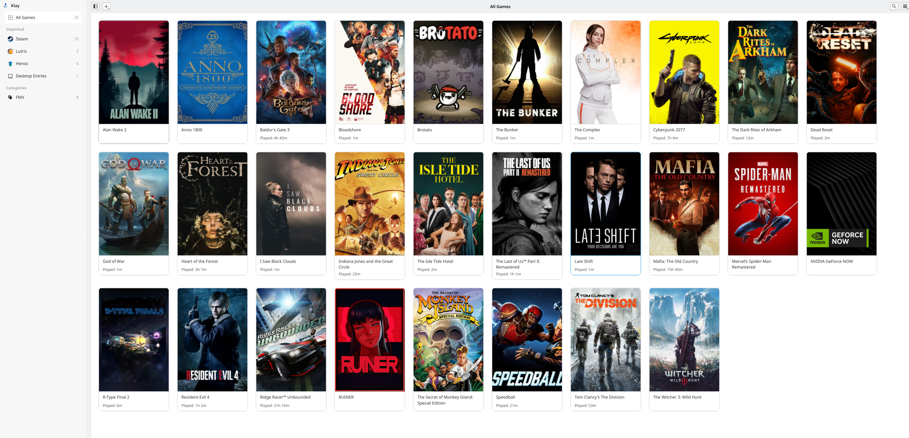
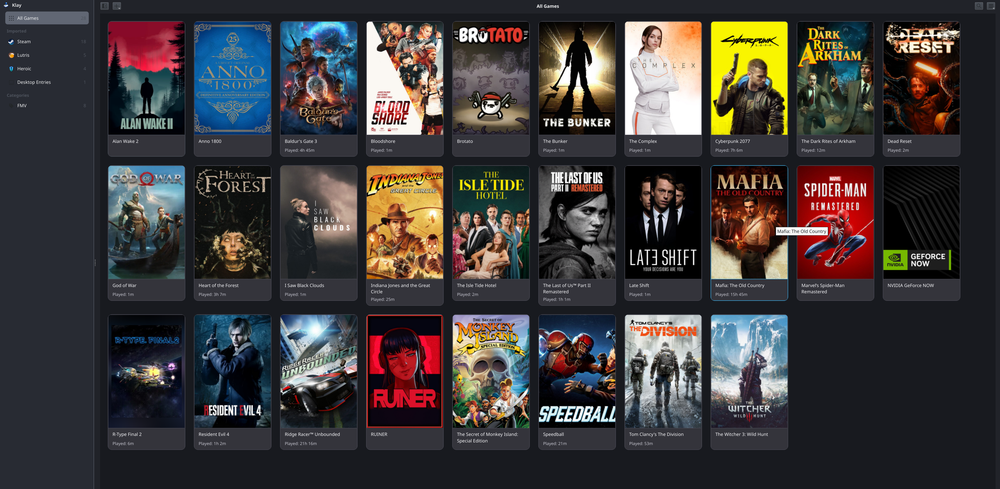
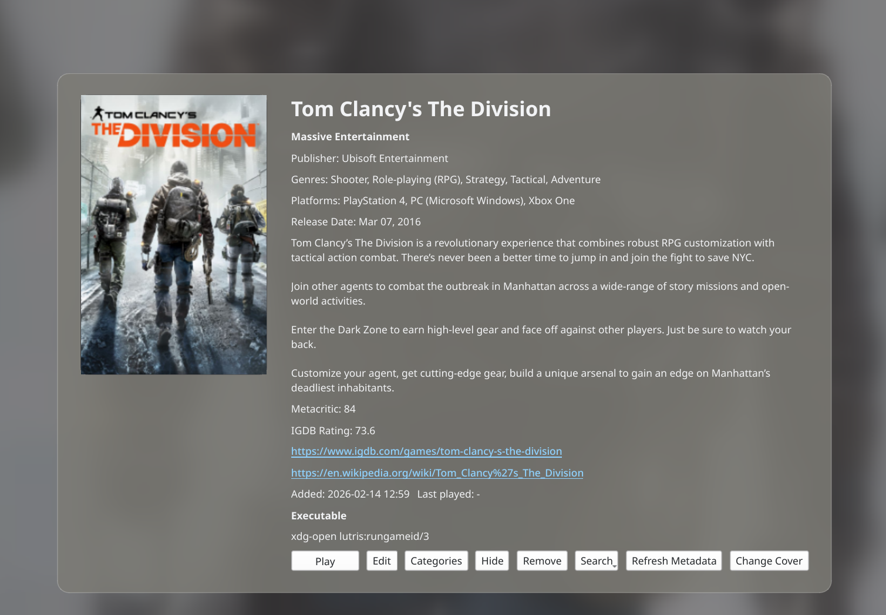
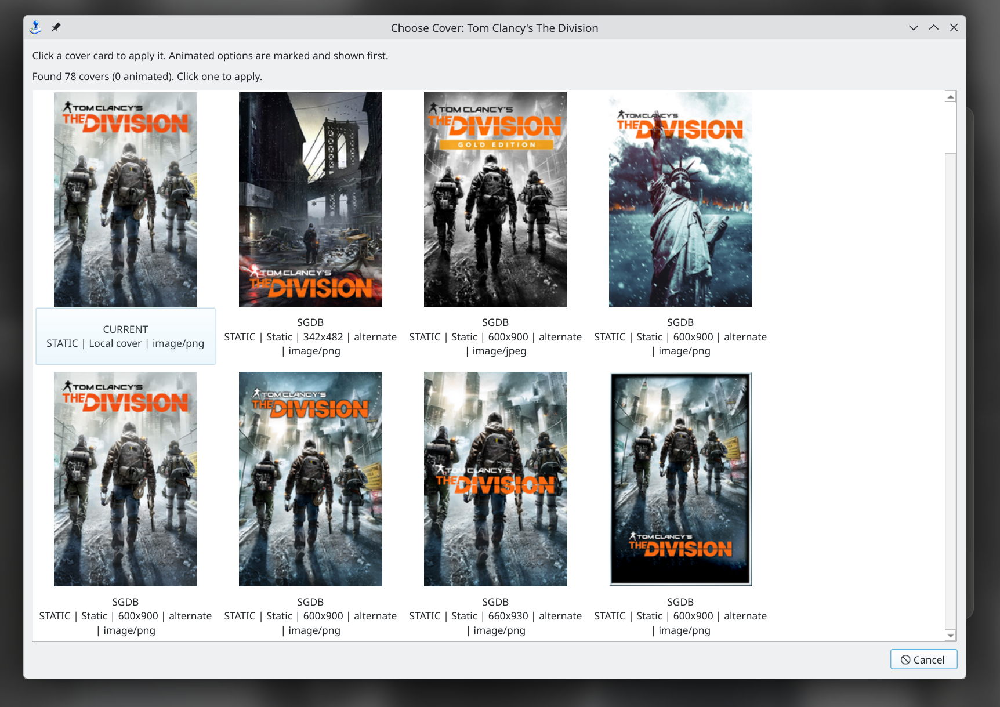

# Klay - Play your games on KDE

**Note:** Klay kind of sucks until you provide a streamgrid api key and also a IGDB api key. It's kind of a pain to create these but worth it!

I built Klay because I love Linux and I am also a huge gaming nerd. I recently switched to Bazzite (based on Fedora, btw.), and my game library was scattered across too many places.

Some were in Steam. Some were cloud-only in GeForce NOW (thank you anti-cheat), and some were from Heroic, Lutris, Bottles, itch, or random desktop launchers. I wanted one launcher that felt native on KDE and gave me one clean library to manage. I was tired of the different ways to launch games. I used Cartridges for a long time, but I felt the time was right to go in a different direction. Something that suited me, and something I am proud to share in case it helps others as well. 

I use this application/code daily because it solves a real need / want for me. I will continue to evolve it based upon feedback and things that I would use daily as a bazzite gamer! 

**Are you looking for a great game launcher and manager for Linux?**

Klay is that project.

It is heavily inspired by [Cartridges](https://github.com/kra-mo/cartridges) for GNOME, but built around a Qt/KDE workflow.

## AI Assistance

Klay is developed by me, and I also use AI tooling, including Codex, to help with some code, refactoring, debugging, and documentation work. All changes are still reviewed, tested, and curated by me before they are released.

## Why I Built Klay

- I wanted one place for all my games on Linux.
- I wanted it to feel right on KDE, not like a GTK app bolted on.
- I wanted better control over covers, metadata, categories, and launch behavior.
- I wanted GeForce NOW support that works with how Linux users actually run it (Flatpak + cache data).

## Who Klay Is For

Klay is for you if:

- You game on Linux (especially KDE/Bazzite) and use more than one launcher.
- You are tired of hunting through Steam, Heroic, Lutris, and desktop entries just to find what to play.
- You care about organizing your library (covers, categories, metadata) instead of just launching binaries.
- You want a local-first launcher that still supports online metadata when you opt in.

Klay is probably not for you if you only use a single launcher and never want to customize your library.

## What It Does

- Qt desktop app (`PySide6`) tuned for KDE workflows
- Imports from:
  - Steam
  - GeForce NOW
  - Lutris
  - Heroic
  - Bottles
  - itch
  - Legendary
  - RetroArch
  - Flatpak
  - Desktop Entries
- Main library cover grid with animated cover support (`.gif`, animated `.webp`)
- Game details page with metadata and quick actions
- SteamGridDB + IGDB integration for covers and metadata (you provide your own API keys)
- Playtime on game cards when source data is available
- Category management (create, rename, delete, assign, custom icons)
- Couch-friendly Big Picture Mode with native controller navigation
- Optional offline game jail for local Windows games, with a separate game copy, Wine prefix, saves, and launch log
- Optional splash screen + startup sound

## Screenshots

<p align="center">
  
  
</p>

<p align="center">
  
  
</p>

## Download (Flatpak)

Latest releases:

`https://github.com/gshipley/Klay/releases/latest`

Install from a downloaded release asset:

```bash
flatpak install --user --reinstall ./com.grantshipley.Klay.Devel.flatpak
flatpak run com.grantshipley.Klay.Devel
```

## Build From Source

For a native Linux development build, install the runtime dependencies below
and the Meson build tools (`gettext`, `glib2-devel`, and `desktop-file-utils` on
Fedora), then run:

```bash
./build-aux/dev setup
```

This creates a persistent `.venv` in the checkout, reuses the host's Python
packages, and installs Meson and Ninja into that environment. On Toolbox or
Distrobox, the script builds and runs on the desktop host so graphics libraries
match the installed driver. It does not install system packages.

Build and run the current source:

```bash
./build-aux/dev run
```

Run the build checks and tests without opening the app:

```bash
./build-aux/dev test
```

Use `./build-aux/dev build` to compile without launching. Rerun `setup` after
changing the host Python version or moving the checkout; it regenerates the
Meson build with the current interpreter.

## Runtime Dependencies

- Python 3 (3.11 or newer for the Linux jail)
- PySide6 (Qt frontend)
- PyGObject (`gi`, GLib/Gio bindings used by import backends/settings)
- PyYAML (Lutris jail detection and Bottles imports; included in the Flatpak)
- Requests and Pillow (game metadata and cover images)
- Brotli Python module (needed for full GeForce NOW library cache decoding)

Fedora:

```bash
sudo dnf install python3-pyside6 python3-gobject python3-pyyaml python3-requests python3-pillow
```

Install the Brotli Python module from your distro packages as well if you want full GeForce NOW library imports from a source build.

Pip (user install):

```bash
python3 -m pip install --user PySide6 Brotli PyYAML requests Pillow
```

Optional:

- `ffprobe` for accurate splash sound duration detection
- For source builds, make sure `python3 -c "import brotli"` works in the same Python environment that launches `./_build/klay/klay` if you want full GeForce NOW library imports instead of preview-only fallback.
- Game jail on Linux: host Python 3.11 or newer, Bubblewrap (`bwrap`), and system Wine or a trusted Proton build. These are checked on the host, including when Klay runs as a Flatpak; Klay does not install them. See [game jail setup and limitations](docs/game-jail.md).

## CLI Options

- `klay --search "term"`: open with a pre-filled search term
- `klay --launch GAME_ID`: launch a game directly by id
- `klay -b` or `klay --big-picture`: open fullscreen in the couch-friendly Big Picture Mode

## Big Picture Mode

Use `F11` or the main menu to enter a fullscreen library with larger game cards
and simplified controls. With a controller, use the D-pad or left stick to
navigate, A/Cross to select or play, B/Circle to go back, and Start/Menu to open
the main menu. To close Klay with a controller, press Start/Menu, navigate to
`Quit Klay`, and confirm with A/Cross. Klay detects controllers connected before
or after startup and shows their connection state in the Big Picture header.

Keyboard controls remain available: use the arrow keys to navigate, `Enter` or
`Space` to select, and `Escape` or `Backspace` to go back or leave Big Picture
Mode. Keyboard-emulating TV remotes and Steam Input mappings use the same keys.

Enable `Start in Big Picture Mode` under `Preferences -> General` to make it
the default at startup, or launch once with `klay --big-picture`.

Native controller access in the Flatpak requires Flatpak 1.15.6 or newer.

## Using Klay

### Import games

- Use `Import` from the main UI.
- Enable/disable sources in `Preferences -> Sources`.
- Configure source paths if your launchers are in non-default locations.
- You can trigger an on-demand import from `Preferences -> Import -> Import Games Now`.

### Run a local Windows game in a jail

The optional jail runs a local Windows game offline, using a separate copy of
its game folder and a private home folder. It also creates a separate Wine
prefix: the Windows environment that holds settings, installed dependencies,
and many games' saves. Your original installation and its existing prefix are
left untouched.

1. Install host Python 3.11 or newer, Bubblewrap (`bwrap`), and a trusted Wine or
   Proton build. Klay checks these but does not install them.
2. Edit a Lutris Windows game and enable `Run in a jail (offline)`. Wait for
   automatic detection, then save with `OK`. Klay can resolve supported Windows
   shortcuts too. Use `Advanced settings` if detection needs help or you are
   setting up another local Windows game.
3. Select `Play` and wait for the first copy and Windows environment setup.
4. Use `View Jail Log` to inspect a launch, `Open Jail Folder` to find its files,
   and `Stop Jail` if a running game gets stuck.

The first launch needs extra disk space for the whole game, plus its new prefix
and saves, and can take a while. Preparation cannot currently be cancelled with
`Stop Jail`; closing Klay waits for it to finish. Later launches reuse the copy.
Changes and saves are **not synchronized** with the original installation.
Disabling jail mode returns to the normal launch command and keeps the jail;
deleting the jail folder also deletes the saves inside it.

Games that need online sign-in, DRM, anti-cheat, downloads, or dependencies from
an existing prefix may not work. Compatible standard Linux gamepads connected
before launch are supported; reconnects may require relaunching. Raw HID
controller features and Steam Input integration are not provided.

The jail reduces exposure, but shares your Linux kernel, GPU, audio, and desktop
services. X11 can expose other desktop applications. It is not a virtual machine
or a verdict that a game is safe, and it does not restrict Klay's own launcher
permissions. If isolation fails, Klay stops the launch. See the
[complete guide, including setup and known limitations](docs/game-jail.md).

GeForce NOW notes:

- Requires NVIDIA GeForce NOW Flatpak (`com.nvidia.geforcenow`) installed.
- Imports linked GeForce NOW library entries from local GeForce NOW cache:
  - Full owned-library pages from Chromium HTTP cache:
    - `~/.var/app/com.nvidia.geforcenow/.local/state/NVIDIA/GeForceNOW/CefCache/Default/Cache/Cache_Data`
    - `~/.local/state/NVIDIA/GeForceNOW/CefCache/Default/Cache/Cache_Data` (fallback)
  - `~/.var/app/com.nvidia.geforcenow/.local/state/NVIDIA/GeForceNOW/CefCache/Default/Service Worker/CacheStorage`
  - `~/.local/state/NVIDIA/GeForceNOW/CefCache/Default/Service Worker/CacheStorage` (fallback)
- Full-library import behavior:
  - Klay prefers cached `requestType=apps` GeForce NOW responses from the Chromium HTTP cache because those correspond to the full owned-library view and include pagination.
  - If those responses are missing or cannot be decoded, Klay falls back to the smaller `panels/Library` preview data from the service-worker cache.
  - Steam ownership data can still supplement supported Steam titles that are not already present in the cached GeForce NOW library data.
- Cover behavior:
  - Klay prefers GeForce NOW catalog `KEY_ART` when available instead of wide hero/banner art.
  - Square GeForce NOW `KEY_ART` is cropped to fill the portrait card instead of being shown as centered art on a blurred background.
  - After upgrading, the next GeForce NOW import rewrites existing GFN square-`KEY_ART` covers once in bulk so older blurred-background cards are replaced automatically.
- Uses the GeForce NOW catalog API to resolve launch-route metadata (`cmsId`, `shortName`, `parentGameId`, store variant ids).
- Launches through the GeForce NOW Flatpak entrypoint with `--url-route`:
  - `flatpak run --command=/app/cef/GeForceNOW com.nvidia.geforcenow '--url-route=#?cmsId=...&launchSource=External&shortName=...&parentGameId=...'`
- Supports linked store variants present in your GFN library (Steam, Epic, Xbox/Game Pass, Ubisoft Connect, EA App, and other stores exposed by GFN variants).
- GeForce NOW count differences:
  - The GeForce NOW client count is the number of app cards in your library.
  - Klay imports store-linked variants as separate entries when GFN exposes multiple owned stores for the same title, so Klay can show a higher count than the GeForce NOW app.
  - Steam fallback can also add supported Steam titles beyond what appears in the cached GeForce NOW library.
- Persists store metadata on imported games so details can show source + store (text and logo when a logo asset exists).
- Re-import does not create duplicate entries for existing IDs; it refreshes launch/store metadata when values change.
- Installed Steam titles are still considered.
- Steam games you own but do not have installed are read from local Steam data (`userdata/*/config/localconfig.vdf`) when available.
- Public Steam profile lookup is only a fallback when local Steam ownership data is unavailable and GFN library cache data is unavailable.
- By default, GeForce NOW entries appear under the `GeForce NOW` source filter and are not included in `All Games`.

`Preferences -> GeForce NOW` includes:

- `Include GeForce NOW games in All Games`
- `Close GeForce NOW after stream ends (best effort)`

### Browse and filter

- Left nav shows:
  - `All Games`
  - `Added`
  - source groups
  - custom categories (if assigned)
- Search filters by title, source/store metadata fields, and categories.
- Sort modes include A-Z, Z-A, newest, oldest, and last played.

### Game details

From details view you can:

- Play
- Edit
- Hide / Unhide
- Remove
- Search external databases
- Refresh metadata
- Change cover
- Manage categories
- View GeForce NOW source + store badges (for example Steam, Epic, Ubisoft, Xbox) when store metadata is available

Click outside the details card to return to the main library.

### Covers and animation

- Supports static and animated covers.
- Cover picker shows candidates in card form and marks animated options.
- Animated covers are prioritized when enabled.
- Custom chosen covers are preserved and not overwritten by startup auto-import.

### Metadata providers

`Preferences -> SteamGridDB`:

- Add SGDB API key
- Enable cover lookup
- Prefer SGDB covers
- Allow animated SGDB covers
- Optionally include image updates during metadata refresh

`Preferences -> IGDB`:

- Provide `Client ID` and either:
  - `Access Token`
  - `Client Secret` (Klay can fetch token automatically)
- Enable IGDB metadata enrichment
- Refresh metadata on demand

## Categories

- Assign categories per game from details view (`Categories`) or right-click menu (`Categories...`).
- Manage definitions in `Preferences -> Categories`:
  - Add
  - Rename
  - Delete (with confirmation)
- Customize category icons in `Preferences -> Categories`:
  - Pick from built-in icon set
  - Upload your own icon
  - Clear custom icon and fall back to default

Category filters show up in the left nav only when games are assigned to that category.

## Preferences

General settings include:

- Dark mode
- Splash screen + startup sound
- Auto import on startup
- Exit after launch
- Cover click launches game vs opens details
- High-quality image preference
- Remove missing imported games

GeForce NOW settings include:

- Include GeForce NOW games in `All Games`
- Optional auto-close of GeForce NOW when a stream ends (best effort)

## Data Paths

Klay uses its own namespace:

- Config: `~/.config/klay/`
- Data: `~/.local/share/klay/`
- Games JSON: `~/.local/share/klay/games/`
- Covers: `~/.local/share/klay/covers/`
- Game jails: host `~/.local/share/klay/jails/` (separate game copies, prefixes, saves, and logs)

## Troubleshooting

### IGDB metadata not loading

- Verify `Client ID` is set.
- Provide either a valid `Access Token` or `Client Secret`.
- If using secret-only mode, ensure outbound access to Twitch token endpoint is allowed.

### Cover picker appears slow

- First open may fetch and cache provider results.
- Subsequent opens use local cache and should be faster.

### A launcher game is missing

- Confirm source is enabled in Preferences.
- Verify source path values.
- Re-run import and check status output in the import dialog.

### GeForce NOW game is missing

- Confirm `GeForce NOW` source is enabled in `Preferences -> Sources`.
- Confirm `com.nvidia.geforcenow` Flatpak is installed.
- Launch GeForce NOW once and open `Library` so both preview and full-library cache data are populated.
- Run one normal import after upgrading so the one-time GeForce NOW cover migration can replace older blurred-background `KEY_ART` covers.
- If you still only see a small subset of your library, confirm the Python runtime used by Klay can import `brotli`, then re-run import.
- For non-Steam titles, make sure the platform account is connected in GeForce NOW and the game appears in your GFN `Library`.
- Ensure Steam has logged in at least once on this machine so local ownership data exists under `userdata/*/config/localconfig.vdf`.
- If local ownership data is missing, Klay falls back to Steam profile lookup.
- If Klay shows more entries than the GeForce NOW client, that is usually expected because Klay imports owned store variants separately and may supplement with Steam ownership data.
- If import reports duplicates for GFN games, that is expected for already-imported entries; Klay still refreshes metadata such as store/source/executable.

### GeForce NOW auto-close not working

- Enable in `Preferences -> GeForce NOW -> Close GeForce NOW after stream ends`.
- This is best-effort behavior based on runtime/log signals and can vary between GFN client versions.

## Project Notes

- App ID: `com.grantshipley.Klay`
- Binary: `klay`
- Python namespace: `klay`
- Extension docs: `docs/klay.md`
